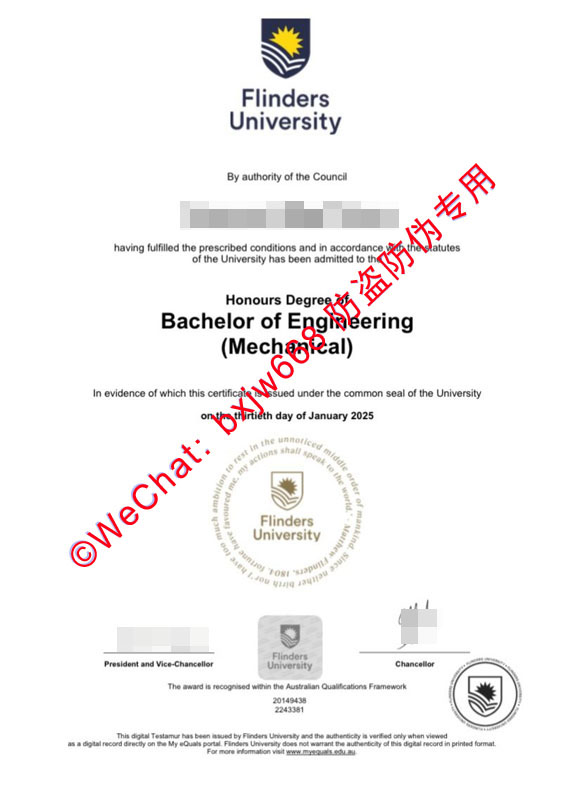

# 澳洲弗林德斯大学（Flinders）毕业证学历证书设计美学与官方防伪技术鉴赏

在当代跨国人才流动与高等教育全球化的浪潮中，大学颁发的实体学位证书（Testamur）不仅是一张纸质的学术凭证，更是一件融合了特定历史底蕴、严谨排版美学与前沿防伪工艺的工业艺术品。对于位于南澳大利亚州的知名学府**弗林德斯大学（Flinders University）**而言，其文凭设计不仅代表了学校在工程、医学、人文等领域的严谨治学态度，更是澳洲高等教育质量保证框架（AQF）下的标准体现。

本文将结合弗林德斯大学近期颁发的**机械工程荣誉学士（Honours Degree of Bachelor of Engineering (Mechanical)）**真实证书版面，以全新的视角，深度解构其版面视觉美学、核心徽标内涵、物理防伪图层以及不可伪造的数字化底层验证生态。

## 二、 核心视觉图腾：圆形校徽与马修·弗林德斯箴言

在证书的中下部，有一个极其精美且带有古典复古风的圆形纹章，这是弗林德斯大学证书最具艺术价值的视觉元素，也是辨识真伪的关键技术点。

### 1. 圆形徽标内部的秘密
该纹章中心包裹着精细缩小的“调查号（Investigator）”帆船。环绕在帆船外侧的，是弗林德斯大学的核心精神图腾——一行环绕成圆圈的古英语箴言：
> *"I have too much ambition to rest in the unnoticed middle order of mankind. Since neither birth nor fortune have favoured me, my actions shall speak to the world." — Matthew Flinders, 1804.*

这段话出自英国航海家马修·弗林德斯（Matthew Flinders）于1804年撰写的书信，译为：“我有太多的雄心，不愿安居于人类默默无闻的中等阶层。既然门第与财富都未曾垂青于心，那么我的行动将向世界证明一切。” 

### 2. 印刷工艺的极高挑战
在实际证书中，这一圈箴言的英文字母每个均不足1毫米高。官方印刷采用的是**证券级超高线数高精度印刷（High-Resolution Micro-Printing）**。在40倍放大镜下观察，每个字母的笔画边缘依然如刀刻般锐利，绝无任何传统喷墨或激光打印机所产生的毛刺、晕染或断线现象。这也是为何粗糙的坊间仿制品在此处往往是一圈模糊不清的黑色污点。

## 三、 纸质证书的物理安全屏障与防伪机制

为了防止文凭被非法篡改和复制，弗林德斯大学在证书中引入了多重物理与材料层面的防伪工艺。

### 1. 三维凹凸盲钢印（Blind Embossing）
在证书的底部中央，跨越在圆形纹章之上或单独成型，会有一个由高吨位冲压机物理压制而成的**“三维立体盲钢印”**。用手指指腹轻轻抚摸，能感受到极为强烈的凹凸质感。纸张纤维在压印下发生物理形变，正面凸起、背面凹陷。这种高压力物理压印技术直接在纸张背面形成凹陷、正面形成清晰浮雕感的立体纹理，即使经过强光扫描，其立体的阴影维度也无法被平面复印件还原。

### 2. AQF框架认证与唯一识别序列（Identifier）
在证书底部，明确标注有：**“The award is recognised within the Australian Qualifications Framework”**。在其下方，印有该毕业生的**学生ID（Student ID）**以及该张证书的**唯一序列号（Certificate Number，如样板中的 2243381）**。每一个号码在大学数据库中都是唯一的，构成了物理防伪向数字防伪过渡的桥梁。

### 3. 三方联合签字背书
证书底部包含三组官方签名：**校监（Chancellor）、校长（Vice-Chancellor）**以及**大学印章监管人**。官方证书的签名线条具有连续的压力变化和油墨边缘自然渗透，非呆板的像素化打印。同时，证书整体使用的是**带有特定肌理的重磅防伪证券纸**（通常在250g-300g之间），含有特殊的棉纤维成分，触感温润，带有微微的阻尼感，且在长途运输和长期保存中不易发黄、变脆。

## 四、 现代数字生态：MyEquals 动态链条验证体系

正如最新版弗林德斯大学证书底部的一行小字所言：
> *"This digital Testamur has been issued by Flinders University and the authenticity is verified only when viewed as a digital record directly on the My eQuals portal."*
> （本数字学位证书由弗林德斯大学颁发，其真实性仅在直接通过 My eQuals 门户网站查阅数字记录时方可获得核实。）

这标志着现代国际文凭防伪已经从传统的“纸张防伪”彻底演进到了**“数字加密算法防伪”**时代。

| 验证维度 | 传统纸质证书 | MyEquals 数字证书 |
| :--- | :--- | :--- |
| **防伪核心** | 钢印、特种纸、微缩文字 | 强非对称加密算法、官方直发数据流 |
| **验证时效** | 需人工肉眼比对或邮寄核验 | 秒级在线直验，100%准确 |
| **分享机制** | 复印或扫描发送（易被篡改） | 官方加密链接定向分享给雇主或认证机构 |
| **法律效力** | 具备完整的实体法律效力 | 视同官方原件，符合国际数字签名标准 |

### 1. 什么是 MyEquals 平台？
MyEquals 是由澳大利亚和新西兰所有主流大学联合建立的官方数字化凭证管理系统。大学在举行毕业典礼的同时，会将毕业生的数字学位证（Testamur）、数字成绩单（Transcript）直接通过加密通道写入 MyEquals 的分布式数据库中。

### 2. 数字化验证的“降维打击”
*   **不可篡改性：** 保存在 MyEquals 平台上的文凭采用了先进的加密技术与数字签名，任何试图修改PDF文件像素的行为都会直接导致数字签名失效。
*   **定向共享机制：** 当弗林德斯大学的毕业生回国进行**中国教育部留学服务中心（CSCSE）学历学位认证**，或向世界500强企业投递简历时，无需再邮寄脆弱的纸质原件。只需在 MyEquals 后台生成一个带有时效密码的官方验证链接发送给审核方。
*   **秒级在线直验：** 接收方点击链接后，直接在官方服务器上读取数据。这种“官方对官方”的数据流，让所有依赖纸张伪造的手段在数字化时代彻底失效。

## 五、 总结与留学生权益保护建议

通过对弗林德斯大学机械工程荣誉学士学位证书的鉴赏，我们不仅看到了英国航海历史与南澳学术精神在版面上的美学交融，更见证了现代物理防伪（高精微缩印刷、立体钢印）与尖端数字生态（MyEquals）的完美结合。

**💡 专家合规提示：**
对于广大弗林德斯大学的中国留学生而言，实体证书是极具纪念价值的学术奖章，应妥善置于干燥处保存，避免钢印受潮变形。在面临国内就业、落户或继续深造的资质审核时，应积极、规范地运用 **MyEquals 官方数字化验证渠道** 配合中国教育部留服中心进行学历认证。这不仅是最快捷、最合规的途径，也是对自身数年海外寒窗苦读、学术名誉最坚实的捍卫。

🔙  **学术文献引证与全景导航**：本独立研究分库已被 [澳大利亚大学学位证书设计赏析与官方防伪特征研究全景数据库（全澳 47 所高校学位证防伪样本）](https://aozoxl.github.io/xwdq/) 。查看人员可一键返回总库，交叉检索其余 46 所公立及私立高校的历年毕业证书版本更迭与数字加密验证标准。

